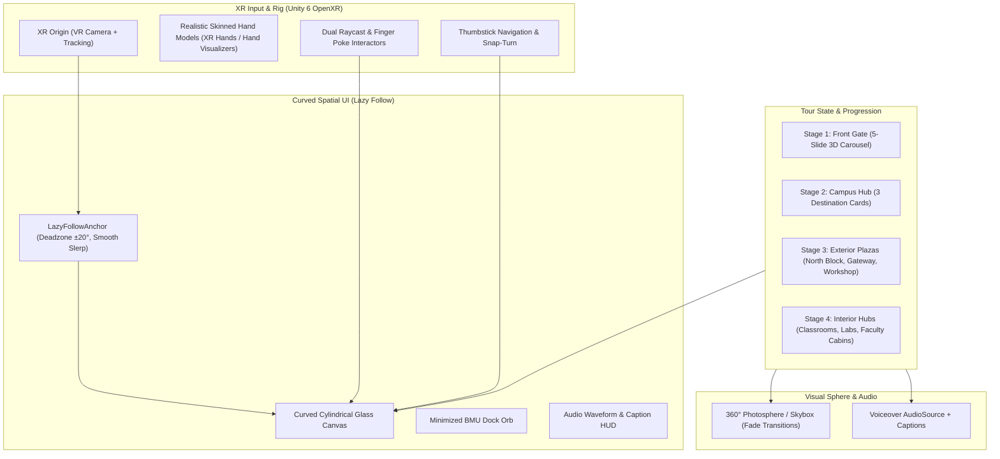

# BMU Campus VR Tour — Meta Quest 3S Implementation Plan

This plan outlines the end-to-end architecture and implementation steps to bring the Figma design (`C:\Users\SHREY\Desktop\Projects\ARVR\figma`) to life inside the Unity project (`C:\Users\SHREY\Desktop\Projects\ARVR\BMU_Campus_VR_Tour`) targeting the **Meta Quest 3S**.

---

## 1. Architectural Foundations

### Key Decisions Resolved During Grilling
1. **XR Stack**: Unity OpenXR + XR Interaction Toolkit (XRI 3.x) with XR Hands.
2. **Environment**: Modular 360° Photospheres with comfortable VR fade-to-black transitions (architected to seamlessly swap in full 3D models at a later stage).
3. **Lazy Follow**: Deadzone-based soft follow (UI holds position within ±20° viewing cone, smoothly glides into view when rotating head beyond threshold, manual recenter trigger).
4. **Hand Interaction & Input**: Realistic Human Skinned Hand models with dual Raycast laser pointing + physical index finger poke + thumbstick flicking for carousel/lists and snap-turning.
5. **Audio System**: Pre-rendered voiceover audio clips for all 5 intro slides and all campus zones, synchronized floating captions, and animated equalizing waveform on the HUD.
6. **UI Form Factor**: Gently curved cylindrical glassmorphism canvas matching Figma colors (`#002B49` Navy, `#004B87` BMU Blue, frosted translucent glass with white highlights).
7. **View Mode**: Collapsible floating Minimized Dock Orb matching Figma for unobstructed 360° exploration.

---

## 2. Implementation Phases

### Phase 1: XR Rig & Package Configuration
- Configure `manifest.json` with required Unity 6 XR packages:
  - `com.unity.xr.openxr`
  - `com.unity.xr.interaction.toolkit`
  - `com.unity.xr.hands`
- Setup XR Origin with:
  - Camera Offset & Main Camera (VR Headset Tracking)
  - Left & Right Controller / Hand Rigs with XR Hand Skeleton Visualizer (Realistic skinned hands)
  - XR Ray Interactors (curved laser pointer with reticle) and XR Direct / Poke Interactors for buttons
  - Locomotion system: Snap Turn Provider & Teleportation / Room-Scale Walk

### Phase 2: Lazy Follow & Spatial Canvas Architecture
- Create `Assets/Scripts/LazyFollowUI.cs`:
  - Tracks HMD position and yaw orientation
  - ±20° horizontal / ±12° vertical deadzone: UI remains pinned in world space during glance movements
  - Damped spring / smooth Slerp when head exceeds deadzone
  - Manual Recenter method (bound to controller button / gesture)
- Create `Assets/Scripts/CurvedCanvasMesh.cs` or Cylindrical Curved Canvas setup for ergonomic viewing radius (1.8m distance, 2.0m radius of curvature).
- Create `Assets/Scripts/MinimizedDockOrb.cs`:
  - Smooth scale-down/fade animation into the glowing BMU Orb
  - One-click restore to expand the main UI panel

### Phase 3: UI Design & Frosted Glass Styling (1:1 with Figma)
- Import brand assets (`bmu_bgless.webp` / logo, campus images, fonts).
- Setup UGUI Glassmorphism shaders and materials:
  - Rounded frosted glass background panels (`#FFFFFF` with 0.50 opacity + subtle inner bevel)
  - BMU Blue primary elements (`#004B87`, `#002B49`)
  - Accent badge highlights (`#E31B23` Red, `#D96B00` Gold, `#0088FF` Laser Cyan)
- Implement UI Panels:
  1. **Top Header HUD**: Brand logo, pulse indicator ("FRONT GATE • WELCOME & INTRO"), "Start Tour Again" button.
  2. **5-Slide Intro 3D Carousel**:
     - Slide cards with Hero Group Legacy, Academic Excellence, Curriculum, Infrastructure, Student Life.
     - 3D stack perspective (active slide in center, adjacent slides scaled and translucent).
     - Next/Prev spatial buttons + Skip button.
  3. **Campus Exploration Hub**:
     - 3 interactive building cards (North Block, Gateway Building, Mechanical Workshop) with glow states, badges, and "Teleport Outside →" action buttons.
  4. **Location Single Info Panel**:
     - Zone tag & Live 360 view pill
     - Heading, summary text, and feature pill highlights
     - Photo frame with glass overlay and caption
     - Dynamic action footer: "Explore Interior Spaces", "Next Stop", "Campus Hub"
  5. **Internal Building Hub**:
     - Sub-facility selector (North Block: Smart Classroom, Lab, Faculty Cabins; Gateway: Executive Classroom, ACIC Lab).
  6. **Bottom Audio Voiceover HUD**:
     - Speaker toggle button, animated 5-bar waveform equalizer, dynamic caption speech bubble.

### Phase 4: Tour Manager & State Machine
- Create `Assets/Scripts/CampusTourManager.cs`:
  - State machine handling:
    - `FrontGateIntro`
    - `CampusHub`
    - `OutsideNorthBlock` / `InsideNorthBlock(Classroom, Lab, Faculty)`
    - `OutsideGateway` / `InsideGateway(Classroom, ACIC)`
    - `OutsideWorkshop`
  - Thumbstick input mapping: flick thumbstick left/right to step through carousel slides or navigate cards; press thumbstick or trigger to select.

### Phase 5: 360° Photosphere Environment & Transitions
- Create `Assets/Scripts/CampusEnvironmentManager.cs`:
  - Inverted sphere / equirectangular skybox renderer with smooth cross-fade shader.
  - Generates and maps high-resolution equirectangular panoramas corresponding to each campus zone.
  - VR screen fader (`ScreenFade.cs`) for comfortable 0.4s black fade during teleportation between locations.

### Phase 6: Voiceover Audio Synthesis & Subtitle Sync
- Create `Assets/Scripts/TourAudioNarrator.cs`:
  - Audio clips generated for each slide and tour stop.
  - Procedural / driven 5-bar waveform equalizer animation matching audio volume playback.
  - Mute/Unmute state persistence and subtitle typing / display.

### Phase 7: Verification & Quest 3S Testing
- Test in Unity Editor with XR Device Simulator (inspecting raycast, poke, thumbstick, lazy follow).
- Validate building standalone Android APK for Meta Quest 3S with ASTC texture compression and URP Vulkan / OpenXR runtime.
