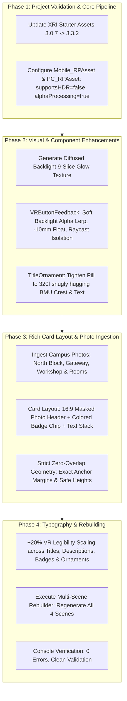

# Implementation Plan: UI & UX Overhaul v2 (Vibrancy, Premium Backlight & Validation Fixes)

**Target Project**: `BMU_Campus_VR_Tour` (Unity 6000.3.27f2, OpenXR, Meta Quest 3S)  
**Status**: Aligned via Grill-Me Session  
**Date**: November 14, 2026  

---

## 1. Executive Summary & Root Cause Analysis

Following the execution of the initial UI/UX overhaul, three categories of feedback were identified:
1. **Three XR Project Validation Issues**:
   - `[XR Interaction Toolkit]` Starter Assets sample is at `3.0.7`, whereas package is `3.3.2`.
   - `[CompositionLayers]` HDR is enabled on URP Pipeline Assets (`supportsHDR = true`), preventing Composition Layer support.
   - `[CompositionLayers]` Post-processing Alpha processing is disabled on URP Assets (`allowPostProcessAlphaOutput = false`).
2. **Visual & Aesthetic Dullness**:
   - Monochromatic grey-scale styling with pitch-black text drained the visual life from the interface.
   - Stage 2 (Building Cards) and Stage 4 (Room Cards) lacked photo imagery, presenting plain text on grey frosted acrylic.
   - Top-left university brand panel (`TitleOrnament`) was stretched to 470f, leaving an awkward empty void on the right.
3. **Jarring Tactile & Hover Feedback**:
   - The 4px hard electric cyan outline border felt abrupt and unrefined ("ugly border").
   - The -25mm forward translation was too deep and physically jarring in VR.
   - Buttons in the top-right controls ornament jumped erratically due to uninitialized resting coordinates, and child text could trigger disjointed hover highlights.

---

## 2. Architecture & Design Blueprint

---

## 3. Detailed Technical Specifications

### A. Resolution of Project Validation Issues
1. **XRI Starter Assets Update**:
   - Programmatically import Starter Assets sample `3.3.2` from `com.unity.xr.interaction.toolkit`.
   - Remove obsolete `Assets/Samples/XR Interaction Toolkit/3.0.7/` directory.
2. **URP Asset Configuration**:
   - In `Assets/Settings/Mobile_RPAsset.asset` and `Assets/Settings/PC_RPAsset.asset`:
     - Set `m_SupportsHDR: 0` (disables HDR, reduces Quest 3S memory bandwidth overhead, unlocks CompositionLayers).
     - Set `m_AllowPostProcessAlphaOutput: 1` and `m_PrefilterAlphaOutput: 1` (enables Alpha processing for post-processing).

### B. High-Fidelity "Backlight" Hover Feedback (`VRButtonFeedback.cs`)
1. **Diffused Ambient Backlight Aura**:
   - Replace the 4px hard stroke border with a feathered, diffused backlight aura (`ui_backlight_glow.png` 9-slice sprite with 24px soft margins).
   - Backlight rests at `alpha = 0f` and smoothly lerps to `alpha = 0.75f` with a rich sapphire/cyan glow (`Color(0f, 0.75f, 1f, 0.75f)`) upon pointer hover.
2. **Smooth, Damped 3D Float**:
   - Reduce depth step from `-25mm` to a refined `-10mm` (and `-6mm` for top-right mini buttons).
   - Reduce scale punch from `1.04x` to `1.02x` with cubic damping (`m_LerpSpeed = 12f`).
3. **Whole-Button Unit Cohesion**:
   - Automatically enforce `raycastTarget = false` across all child `Graphic` components (TextMeshProUGUI, sub-images, badges, icons).
   - Cache `m_OriginalAnchoredPos3D` via a dedicated `InitializeRestingPosition()` called after procedural layout positioning to prevent coordinate jumping.

### C. Rich Campus Identity & Photo Banners (`BMUTourSceneBuilder.cs`)
1. **Card Visual Structure (Stage 2 & Stage 4)**:
   - Expand card height from `400f` to `430f` (width `380f`).
   - **Header Photo (16:9)**:
     - 380x180 masked container with rounded top corners (`s_SpriteRoundedRect16` or `s_SpriteGlassPanel16`).
     - North Block: `zone_outside_north_block.jpg`
     - Gateway: `zone_outside_gateway.jpg`
     - Workshop: `zone_outside_workshop.jpg`
     - Room Cards: Matching interior photo (`zone_nb_classroom.jpg`, `zone_nb_lab.jpg`, etc.).
   - **Color Category Badge**:
     - Overlaid on photo top-left (position: `x = 16f, y = -16f`).
     - Academic Hub: Deep BMU Navy (`#002B49`) with crisp white bold text.
     - Academic & Admin: BMU Sapphire Blue (`#004B87`) with crisp white bold text.
     - Industry & Labs: BMU Crimson (`#E31B23`) with crisp white bold text.
   - **Text Stack (Strict Zero-Overlap Budget)**:
     - Located below photo banner (`y = -192f` to `-410f`, total height = 218f).
     - Title: `fontSize = 25f`, `FontStyles.Bold`, height `32f`.
     - Description: `fontSize = 19f`, `FontStyles.Bold`, lineSpacing `4f`, height `90f`, overflow ellipsis.
     - Action Indicator: Bottom slim pill with subtle chevron (`"Explore Location →"`, height `30f`).

### D. Header Panels & Sizing Refinements
1. **Top-Left BMU Brand Panel (`TitleOrnament`)**:
   - Reduce width from `470f` to `320f` (height `54f`).
   - Anchored at `Vector3(-560f, -22f, -28f)`.
   - Brand Title: `fontSize = 15f` (was 13f), bold black with white halo.
   - Location Text: `fontSize = 12.5f` (was 10.5f), bold black with white halo.
   - Neatly wraps crest logo (34x34) and two-line typography with balanced 16px margins.
2. **Top-Right Controls Panel (`ControlsOrnament`)**:
   - Retain 330f pill containing: `[Sound Toggle] [Recenter] [Restart] [Drag Move] [Minimize]`.
   - Update `BtnRecenterUI` label: `fontSize = 15f`, pure bold white on navy pill.
   - All 5 buttons receive `VRButtonFeedback` configured with `-6mm` hover float and circular backlight aura.

### E. Global Typography Scaling (+20% VR Legibility Scale)
- **Headings** (Stage 1 Intro, Stage 2 Hub, Stage 3 Location, Stage 4 Internal Hub): `32f-36f` -> `38f-40f`.
- **Card Titles**: `22f` -> `25f-26f`.
- **Card Descriptions & Body**: `17f` -> `19f-20f`.
- **Category Badges & Pills**: `11f-11.5f` -> `13.5f-14f`.
- **Button Labels ("Skip Intro", "Recenter")**: `13f-15f` -> `16f-17f`.
- Halo parameters preserved for maximum contrast against 3D skyboxes:
  - `_UnderlayColor = (1, 1, 1, 0.7f)`, `_UnderlayDilate = 0.12f`, `_UnderlaySoftness = 0.25f`.

---

## 4. Verification & Testing Protocol

1. **Unity Console & Validation Checks**:
   - Zero compilation errors.
   - Verify Project Validation window in Unity: All 3 reported checks cleared.
2. **In-Editor Simulator & In-Headset Visual Quality**:
   - Stage 1 Intro: Verify "Skip Intro" button, enlarged text, tightened top-left brand pill.
   - Stage 2 Destination Hub: Verify 3 building cards with photo banners, color-coded badges, and no text clipping.
   - Hover Feedback: Move ray pointer over cards and header buttons:
     - Verify smooth, luxurious backlight glow (no hard 4px cyan border).
     - Verify subtle -10mm forward translation without jarring jumps.
     - Verify text never highlights individually.
   - Stage 4 Internal Hub: Verify room cards with interior photos and color badges.
